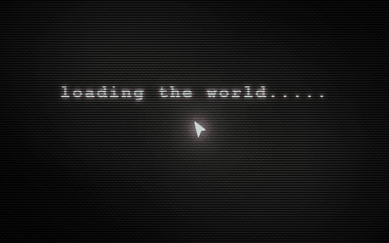

# Phosphor Decay

>  一个零依赖的 CRT 故障美学交互效果：打字机入场 → 点击解密 → 分阶段数据崩坏 → 血色渗出 → 错误代码风暴 → 红闪转场。
> 单文件、纯原生、双击即玩。

[](LICENSE)


**效果预览**



> 动态预览由仓库内的 `index.html` 实际录制，展示从 `DECRYPT` 到转场完成的完整过程。

---

## 目录

- [它是什么](#它是什么)
- [Quick Start](#quick-start)
- [配置项](#配置项)
- [API](#api)
- [崩坏时序](#崩坏时序)
- [无障碍与降级](#无障碍与降级)
- [性能说明](#性能说明)
- [自定义指南](#自定义指南)
- [浏览器支持](#浏览器支持)
- [已知限制](#已知限制)
- [发布到 GitHub Pages](#发布到-github-pages)
- [参与贡献](#参与贡献)
- [License](#license)

---

## 它是什么

一个**可复用的「数据崩坏」过场效果**。适合放在：

- 解谜 / 恐怖 / 赛博朋克题材网页游戏的**场景切换过场**
- 个人作品集、活动页的**开场动画**
- 404 页、彩蛋页、ARG 式交互叙事
- 任何需要「终端被入侵 / 数据被污染」氛围的地方

与 GitHub 上常见的 glitch 片段最大的区别：**崩坏是分阶段编排的，而不是一次性全糊上去**。
字符乱码、文本切片错位、色带扫描、全屏撕裂、血色叠加、错误代码风暴、红闪、闪白、黑屏——
每一层各自有 z-index、各自的触发时机和衰减速率，合起来才有「东西坏掉了」的叙事感。

### 特性

- **零依赖**：无框架、无构建、无 CDN，一个 `index.html` 跑全部
- **可配置**：文案、语料、切片数、风暴强度、时长全部走 `CONFIG`，不用改源码
- **可编程**：`PhosphorDecay.init() / configure() / reset() / destroy()`，并派发 `corruption:done` 事件供转场
- **可重播**：序列结束后自动出现 `REPLAY` 按钮，便于演示与调试
- **尊重 `prefers-reduced-motion`**：光敏人群自动降级为无频闪的静态序列
- **触屏可用**：虚拟光标与粒子拖影只在精细指针设备启用，移动端不会出现卡在屏幕中央的假光标
- **节点池 + 单 rAF 驱动**：错误代码风暴峰值不再堆积上百个 `setInterval`

---

## Quick Start

下载或克隆本仓库后，无需安装任何依赖：

```bash
# 直接双击 index.html，或在仓库根目录启动本地静态服务器
python -m http.server 8000
# 然后打开 http://localhost:8000
```

引入到你自己的页面：

```html
<!-- 1) 复制 index.html 中 <style> 的内容，保存为 phosphor-decay.css -->
<link rel="stylesheet" href="phosphor-decay.css">

<!-- 2) 复制 index.html 中实现效果的 <script> 内容，保存为 phosphor-decay.js -->
<!-- 若不想自动启动，在脚本前关掉 autoinit -->
<script>window.__PHOSPHOR_NO_AUTOINIT = true;</script>
<script src="phosphor-decay.js"></script>

<!-- 3) 需要的 DOM 骨架 -->
<main class="terminal">
  <div class="text-stage" id="textStage">
    <div class="text-layer typing" id="textLayer" role="status" aria-live="polite"></div>
  </div>
  <button class="glow-btn" id="btn" type="button">DECRYPT</button>
</main>
<div class="code-burst" id="codeBurst" aria-hidden="true"></div>
<div class="blood-overlay" id="bloodOverlay" aria-hidden="true"></div>
<div class="red-alert" id="redAlert" aria-hidden="true"></div>
<div class="flash-white" id="flashWhite" aria-hidden="true"></div>
<div class="blackout" id="blackout" aria-hidden="true"></div>

<script>
  PhosphorDecay.init({
    text: 'decrypting archive_07.....',
    errorText: 'ERROR: SUBJECT AWAKE',
    onDone: () => location.href = 'next-scene.html'
  });
</script>
```

---

## 配置项

```js
PhosphorDecay.init({
  text: 'loading the world.....',
  typingSpeed: 100,
  errorText: 'ERROR: DATA CORRUPTED',
  buttonLabel: 'DECRYPT',
  replay: true,
  replayLabel: 'REPLAY',
  slices: 8,
  maxBurstNodes: 90,
  burst: { duration: 2600, interval: 70, whisperChance: 0.22, patchMin: 3, patchMax: 8, initialPatches: 12 },
  enableCursor: true,
  enableParticles: true,
  reducedMotion: 'auto',
  showReducedMotionNote: true,
  onDone: null
});
```

| 键 | 类型 | 默认 | 说明 |
|---|---|---|---|
| `text` | string | `'loading the world.....'` | 入场打字机文本 |
| `typingSpeed` | number | `100` | 打字速度（ms / 字符） |
| `errorText` | string | `'ERROR: DATA CORRUPTED'` | 崩坏定格后的报错文本 |
| `buttonLabel` | string | `'DECRYPT'` | 触发按钮文案 |
| `replay` | boolean | `true` | 序列结束后是否显示重播按钮 |
| `replayLabel` | string | `'REPLAY'` | 重播按钮文案 |
| `corruptChars` | string | 符号 + 方块字符池 | 乱码替换用的字符池 |
| `hiddenWords` | string[] | `HELLO` / `I SEE YOU` / … | 崩坏高峰闪现的可读词 |
| `codeSnippets` | string[] | 24 条错误码 | 错误代码风暴语料 |
| `whisperSnippets` | string[] | 8 条低语 | 慢速、醒目、非错误信息的语料 |
| `slices` | number | `8` | 文本错位切片数，越大越碎 |
| `maxBurstNodes` | number | `90` | 风暴同屏节点上限（性能阀门） |
| `burst.duration` | number | `2600` | 风暴持续（ms） |
| `burst.interval` | number | `70` | 风暴补种间隔（ms） |
| `burst.whisperChance` | number | `0.22` | 每次补种出现「低语」的概率 |
| `burst.patchMin` / `patchMax` | number | `3` / `8` | 单簇节点数区间 |
| `burst.initialPatches` | number | `12` | 开局铺底簇数 |
| `enableCursor` | boolean | `true` | 虚拟光标开关 |
| `enableParticles` | boolean | `true` | 鼠标粒子拖影开关 |
| `reducedMotion` | `'auto'` \| boolean | `'auto'` | `auto` 跟随系统偏好；`true` 强制静态降级 |
| `showReducedMotionNote` | boolean | `true` | 降级模式下是否显示底部提示条 |
| `onDone` | function | `null` | 崩坏序列结束回调（同时派发 `corruption:done`） |

---

## API

```js
PhosphorDecay.init(options)      // 初始化并启动，返回 API 对象
PhosphorDecay.configure(patch)   // 运行时改配置（未初始化时等价于 init）
PhosphorDecay.reset()            // 复位到打字机入场，可重复播放
PhosphorDecay.destroy()          // 解绑事件、清掉全部定时器与 rAF
PhosphorDecay.config             // 当前生效的配置（只读引用）
PhosphorDecay.version            // '1.0.0'
```

**转场钩子**：序列结束时既会调用 `onDone`，也会派发一个全局事件，两种接法任选：

```js
// 方式一：回调
PhosphorDecay.init({ onDone: () => enterNextScene() });

// 方式二：事件（适合解耦）
window.addEventListener('corruption:done', () => {
  window.location.href = 'next.html';
});
```

---

## 崩坏时序

点击 `DECRYPT` 后的完整时间线（默认配置，约 8.5 秒）：

| 阶段 | 起始 | 内容 |
|---|---|---|
| 前置 | 0 ms | 文本快速抖动 3 次（`quickShake`），随后进入崩坏 |
| 崩坏 | ~300 ms | 8 段切片错位 + 乱码强度 `0.24 → 0.55 → 衰减`，每 2 拍扫一次色带；第 4~6 拍随机闪现可读词 |
| 定格 | ~1.3 s | 切片移除，文本定格为红色 `ERROR: DATA CORRUPTED`，全屏开始 0.06s 抖动，**虚拟光标与粒子关闭** |
| A | ~2.0 s | 血色 overlay 渗至 0.6，撕裂条 90ms 一次并逐步加倍 |
| B | ~2.0 s | 报错文本以 45ms 频率剧烈乱码、红白交替、位移抖动 |
| C | ~3.2 s | 报错隐藏，血色升至 0.9；错误代码风暴 2.6s（红/绿/青错误码 + 黄/粉慢速低语） |
| C′ | ~5.8 s | 风暴清空，全屏红色 strobe + 高频撕裂 |
| D | ~6.9 s | 红闪停止 → 闪白 0.5s → 黑屏 0.26s → 派发 `corruption:done` → 出现 `REPLAY` |

---

## 无障碍与降级

满屏频闪、0.06 秒抖动与高频 strobe 对**光敏性癫痫人群是真实风险**，因此：

1. **CSS 层**：`@media (prefers-reduced-motion: reduce)` 下所有 `animation` / `transition` 压到接近静止，扫描线、闪烁、撕裂、频闪全部关闭。
2. **JS 层**：检测到该偏好后走独立的静态降级序列——直接显示报错文本 + 轻度血色 + 黑屏转场，**没有任何频闪与抖动**，转场钩子照常触发。
3. **运行时响应**：用户中途在系统设置里改变偏好，效果会即时切换，无需刷新页面。
4. **提示条**：降级模式下屏幕底部显示一行小字说明当前处于 reduced-motion 模式（可用 `showReducedMotionNote: false` 关闭）。
5. **键盘可达**：触发按钮是原生 `<button>`，带 `:focus-visible` 高亮描边，Tab + Enter 可完整走一遍流程。
6. **语义**：文本层标注 `role="status" aria-live="polite"`，纯装饰层一律 `aria-hidden="true"`。

如需在演示场合强制关闭动画（例如录屏给敏感观众）：

```js
PhosphorDecay.init({ reducedMotion: true });
```

---

## 性能说明

- **单 rAF 打字循环**：错误代码风暴里每条文本的逐字打印由**一个** `requestAnimationFrame` 循环统一驱动，而不是每个节点各起一个 `setInterval`。峰值同屏 200+ 节点时，定时器数量从数百降到 1。
- **节点对象池**：风暴节点销毁后回收到池中复用，避免高频 `createElement` / GC 抖动。
- **同屏上限**：`maxBurstNodes`（默认 90）是硬阀门，达到上限时直接跳过补种，低端设备可自行下调到 40~60。
- **合成层克制**：`will-change` 只加在真正会动的 `transform` / `opacity` 上，没有全屏滥用。
- **自清理**：粒子用 `animationend` 自行移除；所有定时器与 rAF 都登记在案，`destroy()` 可一次性清空，不泄漏。

---

## 自定义指南

**换文案与语料**

```js
PhosphorDecay.configure({
  text: 'Establishing uplink.....',
  errorText: 'ERROR: LINK SEVERED',
  hiddenWords: ['RUN', 'THEY ARE HERE', 'NO EXIT'],
  whisperSnippets: ['help me', 'i am still here', 'do not turn it off']
});
```

**改配色**：样式集中在 `<style>` 顶部的几个类里——
`.text-layer`（正文辉光）、`.text-layer.error`（报错红）、`.code-burst-item.green/.cyan/.whisper/.pink`（风暴配色）、
`.blood-overlay`（血色）、`.red-alert`（红闪）。改 `color` / `text-shadow` / `background` 即可整套换肤。

**加强 / 减弱崩坏烈度**

```js
// 更温和：切片更少、风暴更短、同屏更少
PhosphorDecay.init({ slices: 4, maxBurstNodes: 40, burst: { duration: 1400, patchMax: 4 } });

// 更狂暴
PhosphorDecay.init({ slices: 14, maxBurstNodes: 140, burst: { duration: 4000, interval: 45 } });
```

**做成纯过场（不要重播按钮）**

```js
PhosphorDecay.init({ replay: false, onDone: () => location.replace('/home') });
```

---

## 浏览器支持

依赖 `matchMedia`、`clip-path`、`mix-blend-mode`、`backdrop-filter`、`CustomEvent`、`Set`、`Object.assign` 等现代浏览器能力。

| Chrome | Edge | Safari | Firefox |
|---|---|---|---|
| 79+ ✅ | 79+ ✅ | 13.1+ ✅ | 72+ ✅ |

Safari 上 `backdrop-filter` 需 `-webkit-` 前缀才能生效，缺失时仅按钮少一点毛玻璃，不影响功能。

---

## 已知限制

- 移动端没有 hover，虚拟光标与粒子拖影不会启用（这是刻意设计，不是 bug）；文字层会自动换行、字号下调。
- 崩坏序列进行中不响应第二次点击；需要中途打断请调 `PhosphorDecay.reset()`。
- 文本层默认 `white-space: nowrap`，超长文案在小屏会换行，此时切片错位效果会减弱。
- 效果强依赖 `mix-blend-mode`，若父容器有 `filter` / `transform` 造成层叠上下文变化，混色结果可能不同。

---

## 项目结构

```text
.
├── index.html          # 样式 + DOM + 逻辑（双击即玩）
├── README.md
├── LICENSE             # MIT
├── CONTRIBUTING.md
├── .editorconfig
├── .gitattributes
├── .gitignore
└── assets/
    └── demo.gif        # 完整交互预览
```

---

## 发布到 GitHub Pages

仓库上传到 GitHub 后，进入 **Settings → Pages**，将 **Source** 设为 **Deploy from a branch**，选择 `main` 分支和 `/ (root)` 目录即可。项目无需构建，入口就是根目录的 `index.html`。

---

## 参与贡献

提交前请阅读 [CONTRIBUTING.md](CONTRIBUTING.md)。涉及高频闪光或动画的改动，必须同时验证 `prefers-reduced-motion: reduce` 降级路径。

---

## 灵感与参考

CRT 扫描线美学源自上世纪终端机，故障艺术（Glitch Art）作为流派可参考 Rosa Menkman 的 *Glitch Study/Critical Mistake*；
文本乱码与色散手法与常见的 CSS glitch 片段同源，但本项目的重点在**分阶段编排的时序设计**。

---

## License

[MIT](LICENSE) © 2026 [dgimfjvjd](https://github.com/dgimfjvjd)
